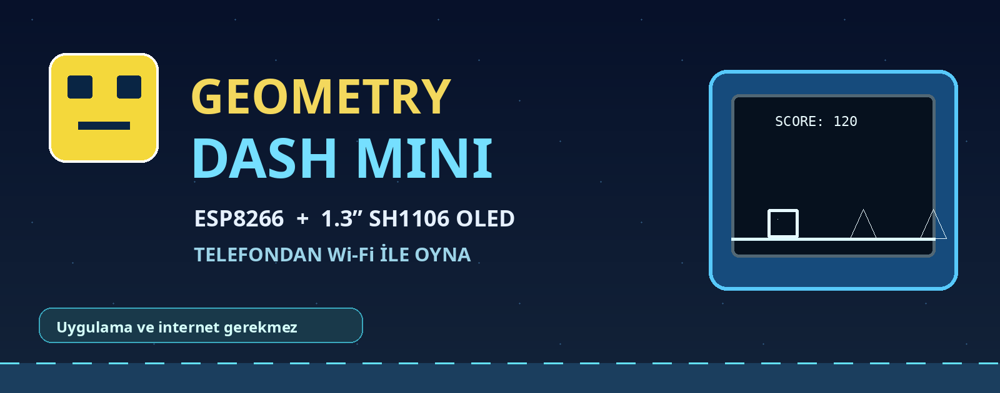
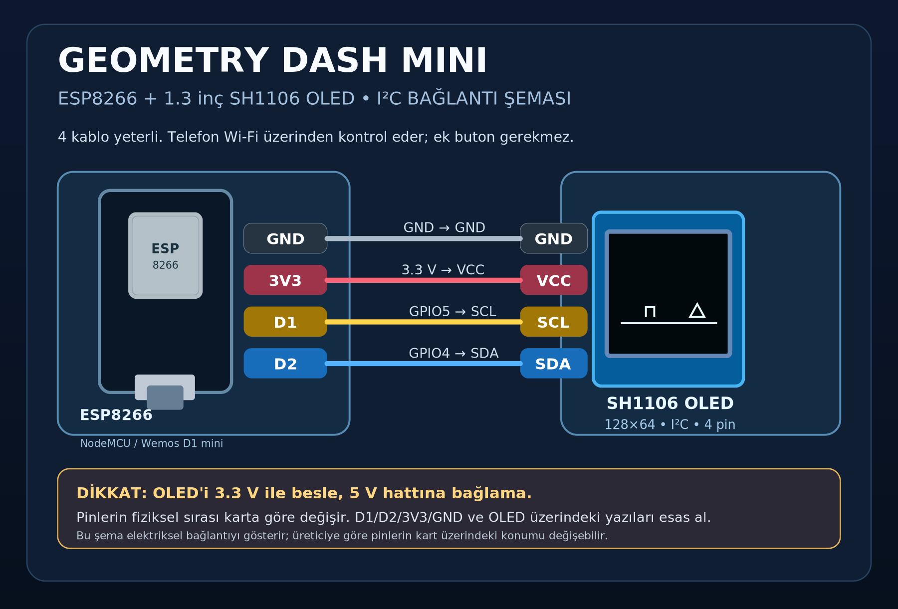
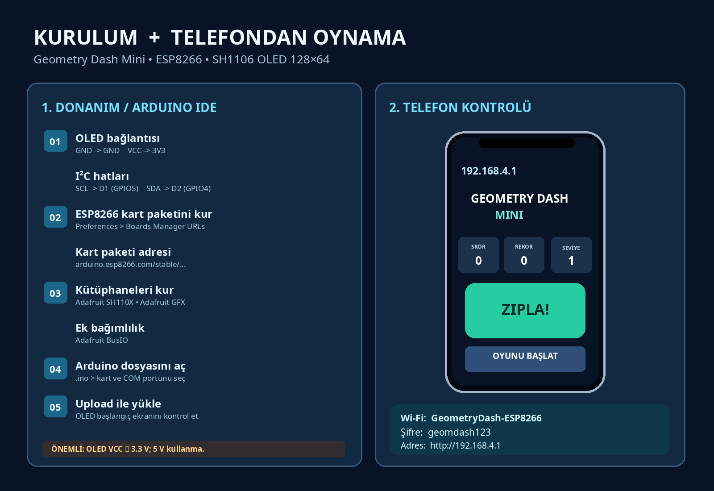

# Geometry Dash Mini — ESP8266 + 1.3” SH1106 OLED



ESP8266 üzerinde çalışan, **1.3 inç SH1106 OLED'de görüntülenen**, **telefonun tarayıcısından Wi-Fi ile kontrol edilen** mini engelden kaçma oyunu. Ek uygulama, internet bağlantısı, buton veya dokunmatik sensör gerekmez.

**Bu repo yüklenen Arduino kaynak kodu temel alınarak paketlenmiştir.** Bağlantı şemaları elektriksel pin isimlerine göre hazırlanmıştır; kart üzerindeki fiziksel pin sıralaması modelden modele değişebilir.

## Özellikler
- OLED'de koşan/zıplayan kare karakter, sivri engeller ve daha ileri aşamalarda blok engeller
- Telefon üzerinden **ZIPLA!** ve **OYUNU BAŞLAT / YENİDEN BAŞLAT** düğmeleri
- Skor ve engel geçiş bonusu; skor yükseldikçe hız ve zorluk artışı
- Oyun sonu ekranı ve **EEPROM'da kalıcı en yüksek skor**
- ESP8266'nın oluşturduğu yerel Wi-Fi ağı; router veya internet gerektirmez
- Telefondaki web sayfasında skor, rekor ve seviye (oyun görüntüsünün telefona aktarımı değildir)

## Bağlantı şeması



| SH1106 OLED (4 pin I²C) | ESP8266 | GPIO |
|---|---|---|
| GND | GND | — |
| VCC | **3V3** | — |
| SCL | **D1** | GPIO5 |
| SDA | **D2** | GPIO4 |

> **Dikkat:** OLED'i **3.3 V** ile besle. 5 V'a bağlama. Bu kod **4 pin I²C SH1106 128×64** içindir; 7 pin SPI OLED için doğrudan çalışmaz. Pinlerin fiziksel sırası model ve üreticiye göre değişebilir; üzerlerindeki `GND`, `3V3`, `D1`, `D2`, `SCL`, `SDA` yazılarını kontrol et.

## Gerekli malzemeler
| Malzeme | Adet |
|---|---:|
| ESP8266 NodeMCU **veya** Wemos D1 mini | 1 |
| 1.3" SH1106 128×64 I²C OLED (4 pinli) | 1 |
| Uygun jumper kablosu | 4 |
| ESP8266 ile uyumlu USB **veri** kablosu | 1 |
| Wi-Fi bağlantılı telefon (tarayıcı) | 1 |

## Arduino IDE kurulumu
1. Arduino IDE → **File / Preferences** → **Additional Boards Manager URLs** alanına şunu ekle:
   ```text
   https://arduino.esp8266.com/stable/package_esp8266com_index.json
   ```
2. **Boards Manager** içinde `esp8266 by ESP8266 Community` paketini yükle.
3. **Library Manager** üzerinden `Adafruit SH110X` ve `Adafruit GFX Library` kütüphanelerini kur. Gerekirse `Adafruit BusIO` bağımlılığını da yükle.
4. `GeometryDashMini_ESP8266_Telefon/GeometryDashMini_ESP8266_Telefon.ino` dosyasını Arduino IDE'de aç.
5. **Tools → Board** üzerinden `NodeMCU 1.0 (ESP-12E Module)` veya kullandığın D1 mini kartını seç; doğru **COM** portunu belirle.
6. **Upload** yap. OLED başlangıç ekranında `GEOMETRY DASH MINI` görünmelidir.

## Telefonla oynama



1. ESP8266 kartına USB ile güç ver.
2. Telefonun Wi-Fi ayarlarından **`GeometryDash-ESP8266`** ağına bağlan.
3. Wi-Fi şifresi: **`geomdash123`**
4. Tarayıcının **adres çubuğuna** `http://192.168.4.1` yaz (Google arama kutusu değil; **https değil**).
5. **OYUNU BAŞLAT / YENİDEN BAŞLAT** ve ardından **ZIPLA!** düğmelerini kullan.

Telefon ağın internete bağlı olmadığını söylerse **bu ağda kal**; gerekirse mobil veriyi geçici olarak kapat. OLED oyunu gösterir, telefon kumandadır.

## Hata giderme
| Sorun | Çözüm |
|---|---|
| OLED açılmıyor | 3V3, GND, SDA=D2, SCL=D1 bağlantılarını kontrol et. Ekranın SH1106 olduğuna emin ol. `OLED_ADDRESS = 0x3C` yerine `0x3D` deneyebilirsin. |
| OLED kararsız/titriyor | Kabloları kısalt; `.ino` içindeki `Wire.setClock(400000);` değerini `Wire.setClock(100000);` olarak dene. |
| Telefon sayfası açılmıyor | `GeometryDash-ESP8266` Wi-Fi ağına bağlı kal; `http://192.168.4.1` yaz; gerekirse mobil veriyi kapat. |
| ESP8266 COM portu yok | USB veri kablosu ve kartın USB-seri sürücüsünü (CH340/CP210x vb.) kontrol et. |
| Ekranım 7 pin | Bu 4 pin I²C örneği SPI ekrana uygun değildir. |
| I²C adresini bilmiyorum | `tools/I2C_Adres_Tarayici/I2C_Adres_Tarayici.ino` dosyasını yükle; 115200 baud Serial Monitor'den adresi oku. Sonra oyun kodunu yeniden yükle. |

## Proje dosyaları
```text
esp8266-oled-geometry-dash-mini/
├── GeometryDashMini_ESP8266_Telefon/
│   └── GeometryDashMini_ESP8266_Telefon.ino
├── docs/
│   ├── devre-semasi.png
│   ├── devre-semasi.svg
│   ├── kurulum-ve-oynama.png
│   └── kapak.png
├── tools/
│   └── I2C_Adres_Tarayici/
│       └── I2C_Adres_Tarayici.ino
├── README.md
├── README_TR.md
├── GITHUB_YUKLEME_KOMUTLARI.txt
├── LICENSE
└── .gitignore
```

## Teknik bilgiler
- `ESP8266WebServer` HTTP üzerinden `/` (web kumandası), `/jump`, `/start` ve `/status` yollarını sunar.
- Oyun fiziği hedefi 50 güncelleme/sn; OLED çizimi en çok 25 kare/sn.
- Rekor `EEPROM` içinde saklanır; farklı bir rekor elde edildiğinde oyun sonu aşamasında kaydedilir.
- Kod varsayılan OLED adresi `0x3C`, varsayılan I²C hızı `400 kHz` olacak şekilde verilmiştir.

## Doğrulama ve lisans
Paketin dosya bütünlüğü ve kaynak koddan alınan bağlantı/SSID/web adresi bilgileri kontrol edilmiştir. **Gerçek ESP8266+OLED üzerinde derleme ve oynanış testi burada yapılmadı.** Donanım testini tamamladıktan sonra README'ye kart modeli, ekran adresi ve test sonucunu ekleyebilirsin.

Örnek MIT lisansı `LICENSE` içinde verilmiştir. Projeni farklı koşullarda paylaşmak istiyorsan yayınlamadan önce lisansı değiştir.
